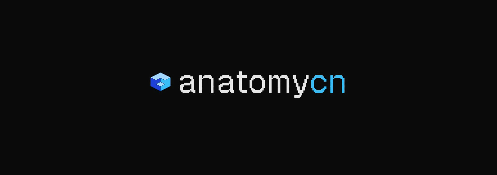
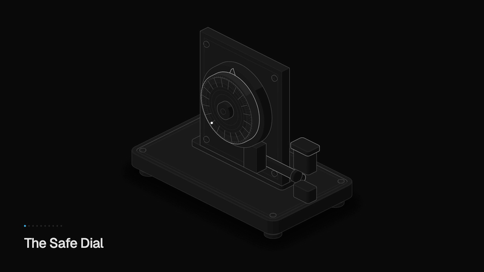

isometric svg components that actually move. every figure is a hand-built drawing
animated off a single number, and it drops into any react project with the shadcn
cli.

live at [anatomycn.vercel.app](https://anatomycn.vercel.app).



tldr; ten figures - a zip, a turntable, a padlock, a safe, an escalator, a
scanner, a combination dial, a loom, a lighthouse and a claw machine. no svg
files to hunt down, no animation library, no runtime dependency on this site.

## why

two things i wanted to find out. how far
[the anatomy skill](https://github.com/wheresryan22/anatomy) actually goes when
you lean on it, and what the free models on opencode can do with something this
fiddly.

so i pointed every model i could at the same brief. deepseek v4.1 flash was the
only one that came back with something decent - every other model wasn't close.
which is funny, because the anthropic models are supposedly the good ones at
exactly this. hehe maybe deepseek is just distilled anthropic models :p

all of this is what came out of that run, so the look of it belongs to
[wheresryan22](https://github.com/wheresryan22/anatomy) and the skill he wrote.

## the idea

every figure is one drawing running off a single number between 0 and 1, looping
on it. that's why it moves like the object moves instead of like a css
transition - the whole loop is written. drop one in and it plays itself; `playing`
starts and stops it, `theme` picks the plate, and there is no number of yours to
feed it.

so the zip opens while the settings panel opens, the escalator climbs while a
build runs, the lighthouse keeps beaming while your status page stays green. you
wire that up from your side - one flag can drive as many figures as you like - and
the geometry is already written, so you rarely have to touch it.

none of them are cutaway diagrams either. it's the outside of a real object,
doing the thing you built it for, and nothing is drawn opened up to explain how
it works. that was the one rule i didn't break.

each figure also has its own page - what it's for, and a few places it earns its
keep.

## the figures

| figure | it's for |
| --- | --- |
| `the-zip` | a settings panel that opens as options are switched on |
| `the-turntable` | a now playing panel in an audio product |
| `the-padlock` | a locked feature, gated behind a plan |
| `the-safe` | a vault, backup or data residency feature |
| `the-escalator` | an onboarding flow that looks like progress instead of a progress bar |
| `the-scanner` | a security, compliance or scanning section |
| `the-safe-dial` | a sign in, PIN or passkey section, where the code is the point |
| `the-loom` | an integrations or data pipeline section, many sources into one fabric |
| `the-lighthouse` | an uptime, status or monitoring page |
| `the-claw-machine` | a search or discovery product, where the pick is the point |

## install

```bash
npx shadcn@latest add https://anatomycn.vercel.app/r/the-zip.json
```

swap the slug for whichever one you want. the item carries the figure, the kit it
needs and the stylesheet, so it lands as a working component with nothing else to
wire up.

two things worth knowing before you run it:

- the only outside packages are the two Hugeicons ones behind the play/pause
  button.
- the files write to `@/components/anatomy/...`, so your project needs the `@/*`
  alias in **three** places: `tsconfig.json`, `tsconfig.app.json` and
  `vite.config.ts`. miss the third one and the cli quietly drops a literal `@/`
  folder at your root instead. (that one cost me an evening.)

if you'd rather build your own figure on the primitives, there's a kit item too:

```bash
npx shadcn@latest add https://anatomycn.vercel.app/r/anatomy-kit.json
```

## how it's put together

each figure is a folder with three files in it. `the-zip.ts` is pure geometry -
hand it the number, it hands back paths. `the-zip.tsx` owns one
`requestAnimationFrame` loop, writes those paths straight onto the svg elements
through refs, and never re-renders per frame. `the-zip.css` is the frame and the
control.

the pieces they share:

```
src/components/anatomy/
  iso-kit.ts        the 2:1 projection, extrusion, depth sort and the shading
  axis-parts.ts     frames and prisms along an axis, and reading a pointer
                    back onto a plane
  react/draw.tsx    <IsoFigure> <Solid> <Line> <Wire> <Dots> <Plate>
  react/live.tsx    useInView, useLoop, spring, reduced-motion helpers
  live-solid.tsx    parts that get redrawn every frame
  iso.css           the kit's tokens
```

a figure stops its own loop once it scrolls out of view, which is what makes a
grid of ten of them cheap. every one of them checks `prefers-reduced-motion`
before it moves. pausing is a real pause too - the pointer takes over, and on the
turntable and the loom the tour picks up from wherever you left it instead of
snapping home.

## running it

```bash
cd frontend
npm install
npm run dev
```

`npm run build` runs `tsc -b`, then the registry, then vite. `npm run
registry:build` writes `public/r` on its own.

`frontend/README.md` is the long version of all this - the two routes, the
thirty-line router, the registry spec, the vendored beUI components and the four
local edits i've made to them.

## credits

the isometric kit and the drawing style come from
[the anatomy skill](https://github.com/wheresryan22/anatomy) by wheresryan22,
which is the only reason any of this looks like anything. the figures, the site
and the copy are mine.

if you build something with one of these, i'd like to see it -
[@whotookromeiro](https://twitter.com/whotookromeiro).
